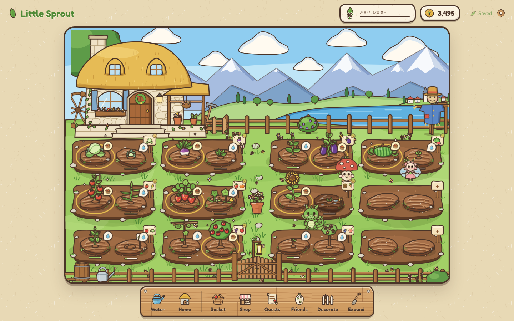
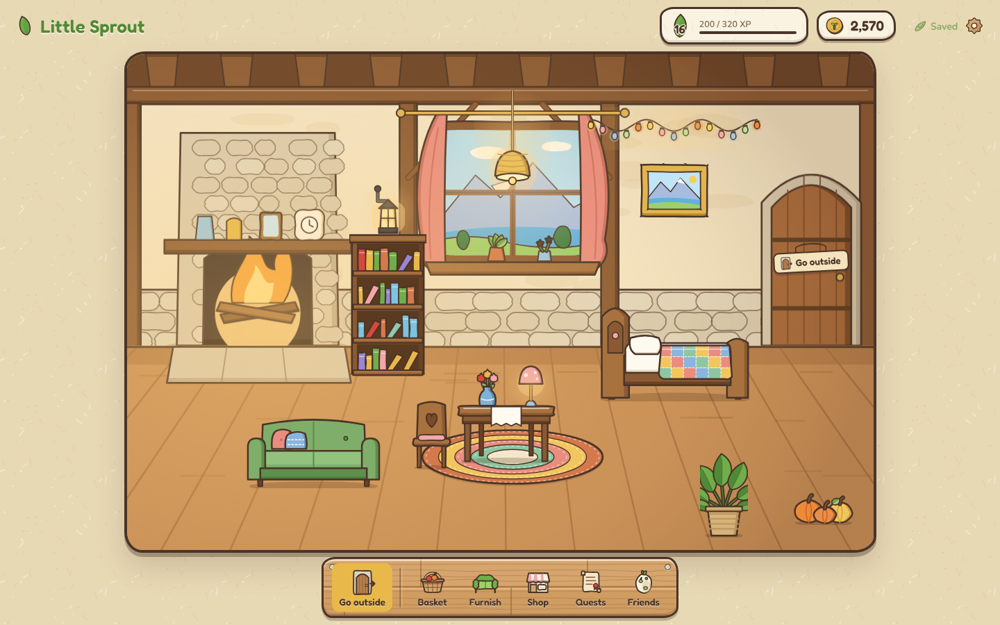

# Little Sprout 🌱

A cozy, hand-drawn fantasy farming game that runs in your web browser.
Plant seeds in a cottage garden below the mountains, water them, harvest,
sell your crops, make friends with garden creatures, finish quests, and
decorate the inside of your thatched cottage with furniture you buy.





All the artwork is original SVG drawn for this game, and everything runs
on your own computer. No accounts, servers or internet connection needed
once it is installed.

**Want to share it with friends and family?** See
[8. Put it online and share it](#8-put-it-online-and-share-it).

**Want your computer's garden on the website?** See
[9. Move your garden from your computer to the website](#9-move-your-garden-from-your-computer-to-the-website).

---

## 1. Install (one time only)

You need **Node.js** (version 18 or newer). Download the "LTS" version from
<https://nodejs.org> and install it like any other program.

Then open a terminal **in this folder** (the one with `package.json`):

- **Windows:** open the folder in File Explorer, click the address bar, type `cmd`, press Enter.
- **Mac:** right-click the folder in Finder → *New Terminal at Folder*.

Run:

```bash
npm install
```

This downloads Vite (the small tool that runs the game) and two font
packages into a `node_modules` folder. You only need to do it once.

## 2. Play

```bash
npm run dev
```

Your browser opens the game automatically. If it doesn't, open the address
the terminal prints, usually <http://localhost:5173>.
To stop the game, click the terminal and press **Ctrl + C**.

### Other commands

| Command | What it does |
| --- | --- |
| `npm run dev` | Start the game for playing and editing. Changes you save show up instantly. |
| `npm test` | Run the automated checks for the game rules (27 tests). |
| `npm run build` | Make a finished copy of the game in the `dist/` folder. |
| `npm run preview` | Play that finished copy from `dist/`. |

---

## 3. How to play

| Action | How |
| --- | --- |
| **Plant** | Click an empty patch of soil and choose a seed (tabs sort them into Vegetables, Fruits and Flowers). After that, every empty patch you click gets the same seed until you press **×** on the green "Planting…" tag. |
| **Check on a plant** | Click it to see its stage, a progress bar and the time left. |
| **Water** | A 💧 bubble means the plant is thirsty. Click the plant and press **Water**, or pick up the **Water** can from the toolbar and click thirsty plants. Wet soil makes plants grow **1.5× faster** for a while. |
| **Harvest** | A basket bubble and a golden ring mean it's ripe. Just click it. |
| **Crop signs** | Every bed has a little wooden sign showing what grows there. Click it to plant, water or harvest the whole bed at once. |
| **Scarecrow** | Click him for a quick report: how many plants are ripe, thirsty or empty. |
| **Garden gate** | The gate at the front opens the seed shop. |
| **Go inside** | Click the cottage door (or **Home** in the toolbar). The screen fades and you're inside. **Go outside** (the door on the right, or the toolbar button) takes you back. Your crops keep growing while you're indoors. |
| **Furnish the cottage** | Inside, open **Furnish** (or **Shop → Furniture** from the garden). Pick a category, press **Buy** and a see-through copy follows your mouse: green means it fits, red means it doesn't (the note says why). Click to put it down, press **F** or **Flip** to turn it around, and **Esc** or **Cancel** to keep it in storage. |
| **Move, flip or store furniture** | Click any furniture in the room. **Store** puts it back in **Furnish → Stored**, ready to place again. Lamps and vases on a table travel with the table. |
| **Sell** | **Shop → Sell**, or from your **Basket**. |
| **Orders** | **Shop → Orders**: neighbours pay extra for specific produce. |
| **Buy seeds, decorations and furniture** | **Shop → Seeds / Decor / Furniture**. |
| **Decorate** | Open **Decorate**, pick an item from your shed, click a glowing circle in the garden. Click a placed item to put it back. |
| **Friends** | Click a creature in the garden (or open **Friends**) to pet or feed it. Happy friends give bigger bonuses. |
| **Quests** | Open **Quests** and press **Claim!** when one is finished. |
| **Expand** | The garden has 12 beds (24 plots); you start with 6. Reach the required level, then **Expand** clears two overgrown beds for 4 more plots (levels 3, 5 and 7). |
| **Settings** | The gear (top right): save now, reduce motion, reset the farm. |
| **Close things** | **Esc** closes pop-ups and panels, puts tools away and cancels furniture placing. |

Plants keep growing while the game is closed: they catch up as soon as you come back.

### The crops

| Level | Vegetables | Fruits | Flowers |
| --- | --- | --- | --- |
| 1 | carrot, radish, lettuce | | |
| 2 | turnip, onion | strawberry | |
| 3 | cabbage, potato, garlic, tomato | | |
| 4 | eggplant, cucumber | blueberry | sunflower |
| 5 | bell pepper, pumpkin | raspberry, watermelon | |
| 6 | corn, chili | | moonbloom |
| 7 | broccoli | grapes | |
| 8 | | apple, pear | |
| 9 | | peach | |

Every crop has its own seed price, growing time, harvest size, sell price and
experience. Cheap starters (carrot, radish, lettuce) grow in under a minute;
bigger crops take longer but are worth more. Root crops (carrot, turnip,
radish, potato, onion, garlic) show their tops above the soil; watermelons,
pumpkins and cucumbers sprawl on vines; apples, pears and peaches grow on
little trees. Cucumbers, garlic and watermelons are thirsty and get an extra
boost from water.

### The cottage furniture

24 items in four groups, each with its own price and unlock level:

- **Furniture:** wooden bed, dining table, chair, bedside table, bookshelf, sofa, wardrobe
- **Lighting:** wall lantern, table lamp, hanging light
- **Decorations:** potted flowers, flower vase, framed painting, round rug, striped runner, wall clock, cushions, wall shelf, indoor plant
- **Special:** cast-iron stove, copper pot rack, harvest wreath, pumpkin trio, fairy lights

Each item knows where it can go: on the floor, flat on the floor (rugs), on
the wall, from the ceiling beam, or on top of a table, bedside table, bed,
sofa or stove. Things can't overlap, cover the fireplace, window or door, or
leave the room. The cottage starts with a bed, a table, a chair and a rug.

### The garden friends

| Friend | Arrives | Loves | Bonus (at 100% happiness) |
| --- | --- | --- | --- |
| **Button**, Puffcap Mushroom | at the start | carrots | 30% chance of an extra item per harvest |
| **Posy**, Flower Sprite | level 3, 120 coins | strawberries | +25% experience from harvests |
| **Sprig**, Leaf Dragon | level 5, 300 coins | sunflowers | every crop grows 20% faster |

Bonuses shrink as happiness drops, and happiness drifts down slowly over time,
so check in on your friends. Petting gives +8 (once every 15 seconds), a favourite
snack gives +25 and any other produce +12.

---

## 4. Changing the game (customisation)

Everything you're likely to want to tweak lives in `src/data/`. Save a
file while `npm run dev` is running and the browser updates by itself.

| I want to… | Edit |
| --- | --- |
| Make crops grow slower (real-time farming) | `src/data/config.js` → `GROWTH_TIME_SCALE`. `1` = quick testing times (carrots take 30 s). `60` turns every second into a minute. |
| Change starting coins or seeds | `src/data/config.js` → `STARTING_COINS`, `STARTING_SEEDS` |
| Change how strong watering is | `src/data/config.js` → `WATER_SPEED`, `WATER_DURATION_SHARE` |
| Change prices, sell values, XP or unlock levels | `src/data/cropsData.js` |
| Change creature bonuses, prices or favourite foods | `src/data/creaturesData.js` |
| Add or edit quests | `src/data/questsData.js` (the comment at the top lists quest types) |
| Change decorations | `src/data/decorData.js` |
| Change furniture (prices, sizes, where it may go) | `src/data/furnitureData.js` (the comment at the top explains each field) |
| Change the room's walls, floor and blocked areas | `src/data/houseLayout.js` |
| Move beds, the cottage, scarecrow, gate, decoration spots or creature walking spots | `src/data/gardenLayout.js` |
| Change expansion costs | `src/data/config.js` → `EXPANSIONS` |
| Change colours and fonts | top of `src/styles/main.css` |

### Adding a new crop

1. Add an entry to `src/data/cropsData.js` with a new `id`, for example `kale`, and a `category`
   (`vegetable`, `fruit` or `flower`). You can also give it its own `waterSpeed`.
2. Add pictures with matching names:
   - `src/assets/crops/kale-0.svg` to `kale-3.svg` (seed, sprout, growing, ready)
   - `src/assets/produce/kale.svg` (the harvested item)
   - `src/assets/seeds/kale.svg` (the seed packet)

   The easiest start is to copy the carrot files and edit the colours.

### Editing the artwork

Every picture is a plain `.svg` file in `src/assets/`. You can open them in
a free editor such as [Inkscape](https://inkscape.org), or in a text editor
to change colours (look for `fill="#ec8a3a"` and similar). Keep the same
file names and the game picks up your changes.

Art conventions, so new drawings match:

- Outline colour `#4a3428` (warm dark brown), round line joins.
- Line width about 2.8 in the 100-wide crop pictures, 3 in the 64-wide icons.
- Cel shading: each shape has a flat base colour, one darker crescent on its
  lower-right side and a small cream highlight on the upper-left. Leaves are
  split down the middle, with one half a shade darker.
- The shading uses SVG `<clipPath>`s. Each file gives its clip ids a unique
  prefix (for example `carrot3-1`), so if you copy a file, rename the ids too.
- Crops are drawn in a 100 × 120 box with the base of the plant at about y = 106.
- Soil plots come in three shapes (`garden/plot-0.svg` to `plot-2.svg`, each
  with a `-wet` version). The game picks one per plot so beds don't look stamped.
- The garden is built from separate layers, not one flat picture: the valley
  background (`garden/background.svg`: sky, mountains, lake, village, hills,
  fences and soil beds), the cottage (`garden/cottage.svg`, its door and water
  wheel animate), the scarecrow, the gate, the crop signs, the soil plots and
  the crops, each positioned by the game.
- The cottage inside is `house/interior.svg` (1200 × 800). Furniture lives in
  `src/assets/furniture/`, one file per item, drawn to fill its size.
- Panels, buttons and the toolbar get their paper and wood textures from
  `src/assets/ui/` and `src/styles/art.css`.

### Adding new furniture

1. Add an entry to `src/data/furnitureData.js` (id, name, category, cost, unlock level, where it can go, size).
2. Draw `src/assets/furniture/<id>.svg` with a `viewBox` of `0 0 w h` matching its size, standing on the bottom edge.

### Developer shortcuts

While `npm run dev` is running, open the browser's developer console
(F12 → Console) and type:

- `sprout.warp(60)` skips 60 seconds ahead, so plants grow instantly.
- `sprout.coins(500)` adds 500 coins.

These only exist in development mode, not in the built game.

---

## 5. Saving

- The game saves to your browser's local storage after every action, every 10 seconds, and when you close the tab. The "Saved" note at the top flashes when it does.
- Saves belong to **this browser on this device**. A different browser or device starts a new garden.
- This is also true online: everyone who opens the game's link gets **their own garden**, saved in their own browser. Sharing the link does not share your garden, and nobody can see or change anyone else's progress. There are no accounts and nothing is stored on a server.
- Clearing your browser's history/site data, or playing in a private/incognito window, removes the save.
- Saves made before the cottage update are upgraded automatically: crops, coins, quests, friends and decorations all stay, and the cottage gets its starter furniture. Before upgrading, the old save is copied to `little-sprout-save-backup-v1` in the browser's storage, once, and never overwritten.
- Furniture you own is never thrown away: if a saved item no longer fits where it was, it goes back to storage.
- If a save is damaged or from an older version, the game keeps everything it can understand and fills in the rest, so changing the game's code won't wipe your progress. A completely unreadable save is set aside (as `little-sprout-save-broken`) and a new garden begins.
- **Settings → Reset farm** starts over, after asking you to confirm. One copy of the garden you reset is kept (as `little-sprout-save-before-reset`).
- **Settings → Move your garden** saves your garden to a file and loads a garden from a file, so you can carry it to another browser, another computer or the website. See section 9.
- Settings also lists every older copy kept in this browser (before the cottage update, before a reset, before loading a file, or one that couldn't be read). Each can be downloaded as a file or switched back to, always after a "Replace my garden?" check.

---

## 6. Project layout

```
index.html              the page
src/main.js             starts the game
src/data/               numbers and lists you can edit (crops, quests, layout…)
src/systems/            game rules, no drawing code (easy to test)
  game.js               runs actions, counts quests, saves
  crops.js              planting, growth over time, watering, harvesting
  economy.js            coins, levels, selling, market orders
  creatures.js          happiness, petting, feeding, bonuses
  quests.js             quest progress and rewards
  decorations.js        buying and placing decorations
  home.js               the cottage: buying, placing, moving, storing furniture
  expansion.js          unlocking more garden beds
  saveManager.js        loading, checking and saving the game
src/components/         everything on screen
  app.js                connects the screen to the game rules
  garden.js             the garden scene: beds, cottage, scarecrow, gate, crop signs
  house.js              the cottage interior and furniture placement
  hud.js, dock.js       top bar and bottom toolbar
  shop.js, inventoryPanel.js, questPanel.js, creaturePanel.js,
  decoratePanel.js, expandPanel.js, settingsPanel.js,
  furnishPanel.js       the side panels
  effects.js            floating rewards, toasts, confetti
src/styles/             main.css (colours, buttons), garden.css, ui.css,
                        art.css (paper, wood and shading for the interface),
                        house.css (cottage, scarecrow, gate, interior, furniture)
src/assets/             all the SVG artwork
tests/game.test.js      automated tests for the rules
tests/home.test.js      tests for the new crops, furniture and save upgrade
vite.config.js          build settings (relative paths so it works at any web address)
.github/workflows/deploy.yml   publishes the game to GitHub Pages on every push
setup/deploy.yml        a copy of it, to move into place (see 8.4)
```

## 7. Known limitations

- Single player, one garden per browser. There is no cloud save: gardens move between browsers with a save file (section 9), by hand.
- Garden decorations go on 8 fixed spots rather than anywhere you like (cottage furniture can go anywhere it fits).
- The room is seen from the front, so furniture can be flipped left and right but not rotated to face other directions.
- On a phone the garden and cottage are small and placing furniture with a finger is fiddly; a computer or tablet works best.
- Which scene you're in (garden or cottage) isn't saved, so the game always opens in the garden.
- No sound or music yet.
- Creature happiness and growth bonuses use the bonus as it is *now* when catching up on time spent away, so they're a close estimate rather than an exact one.

---

## 8. Put it online and share it

Little Sprout is a **static website**: once built, it's just HTML, CSS,
JavaScript, fonts and SVG pictures in the `dist/` folder. It needs no server,
database or accounts, so it can be hosted for free.

**Recommended: GitHub Pages.** It's free, it gives you a permanent link like
`https://your-name.github.io/little-sprout/`, and this project is already set
up so that every time you upload ("push") changes, GitHub rebuilds and
republishes the game by itself (in `.github/workflows/deploy.yml`). Your
project's history is kept too, so a mistake can always be undone.

*Quicker one-off alternative:* [Netlify Drop](https://app.netlify.com/drop)
lets you drag the `dist/` folder onto a web page (after a free sign-up). It's
fine for a quick test, but you have to drag it again for every update.

The steps below are a one-time setup of about 20 minutes. After that,
updating is three commands.

### 8.1 Install the tools (one time)

1. **Node.js**: you already have it if `npm run dev` works (see section 1).
2. **Git**, the tool that uploads your project: download it from
   <https://git-scm.com/downloads> and install it with the default options.
   Then close and reopen your terminal and check it works:

   ```bash
   git --version
   ```

3. **A GitHub account**: sign up free at <https://github.com/signup>. Your
   username becomes part of the web address, so pick one you're happy to share.
4. Tell Git your name and email (shown in your project history; use the same
   email as your GitHub account):

   ```bash
   git config --global user.name "Your Name"
   git config --global user.email "you@example.com"
   ```

### 8.2 Check the production build on your computer

In the `little-sprout` folder:

```bash
npm install
npm test
npm run build
npm run preview
```

`npm run build` makes the finished website in `dist/`. `npm run preview`
opens it at <http://localhost:4173>. Play a little to check it works,
then press **Ctrl + C** in the terminal to stop it.

> Opening `dist/index.html` by double-clicking it shows a blank page. That's
> normal: browsers block games loaded straight from files. Use
> `npm run preview`, or put it online.

### 8.3 Create the repository on GitHub

1. Go to <https://github.com/new>.
2. **Repository name:** `little-sprout`
3. Choose **Public**. Free GitHub Pages sites need a public repository, and
   the game contains nothing private. (`node_modules`, `dist` and any `.env`
   files are listed in `.gitignore` and never uploaded.)
4. Leave "Add a README", ".gitignore" and "license" **unticked** (the project already has them).
5. Click **Create repository**.

### 8.4 Upload the project (first time)

First, put the publishing recipe where GitHub looks for it. It comes in the
`setup` folder because it can't be placed in the hidden `.github` folder
automatically. In the terminal, in the `little-sprout` folder (Windows):

```bash
mkdir .github\workflows
move setup\deploy.yml .github\workflows\deploy.yml
```

(On a Mac: `mkdir -p .github/workflows && mv setup/deploy.yml .github/workflows/deploy.yml`.
If `.github\workflows\deploy.yml` already exists, for example because you
unzipped the project, skip this.)

Then upload. Replace `YOUR-NAME` with your GitHub username:

```bash
git init
git add .
git commit -m "First version of Little Sprout"
git branch -M main
git remote add origin https://github.com/YOUR-NAME/little-sprout.git
git push -u origin main
```

The first `git push` opens a browser window asking you to sign in to GitHub.
Approve it, and the upload finishes.

### 8.5 Switch on GitHub Pages (first time)

1. On your repository page, open **Settings → Pages** (left-hand menu).
2. Under **Build and deployment → Source**, choose **GitHub Actions**.
3. Open the **Actions** tab. You'll see **Publish Little Sprout** running
   (a yellow dot). If it shows a red ✗ because it ran before Pages was switched
   on, click it and press **Re-run all jobs**. You can also start it by hand with **Run workflow**.
4. When it shows a green ✓ (one or two minutes), the game is online.

### 8.6 Find your public link

- It's shown at the top of **Settings → Pages** ("Your site is live at…"),
  and inside the finished Actions run under **deploy**.
- It's always `https://YOUR-NAME.github.io/little-sprout/`.

Open it yourself first. Then send it to anyone: it works in any modern
browser on computers, tablets and phones, with nothing to install. Each
person gets their own garden (see [5. Saving](#5-saving)).

### 8.7 Update the live game after making changes

Save your changes, check them with `npm run dev` (and `npm test`), then:

```bash
git add .
git commit -m "Describe what you changed"
git push
```

The Actions tab shows the new version being built. A minute or two later the
link shows the new version (press **Ctrl + F5**, or **Cmd + Shift + R** on a Mac,
to skip the browser's cache). Players keep their gardens through updates.

### 8.8 Troubleshooting

| Problem | What to do |
| --- | --- |
| `git` or `npm` is "not recognized" / "command not found" | Install it (8.1), then close and reopen the terminal. |
| `git push` says `src refspec main does not match any` | You haven't committed yet. Run `git add .` and `git commit -m "First version"` first. |
| `git push` is rejected or asks for a password | Sign in through the browser window that pops up. GitHub doesn't accept your account password in the terminal. |
| `remote origin already exists` | Run `git remote set-url origin https://github.com/YOUR-NAME/little-sprout.git` instead. |
| The **Actions** tab shows no "Publish Little Sprout" | The recipe isn't in `.github/workflows/deploy.yml`. Do the first step of 8.4, then `git add .`, `git commit -m "Add publishing"`, `git push`. |
| Actions run fails at **deploy** with "Get Pages site failed" or "Not Found" | Pages isn't switched on yet: do 8.5, then **Re-run all jobs**. |
| Actions run fails at `npm ci` | Make sure `package-lock.json` was uploaded (`git add package-lock.json`, commit, push). |
| Actions run fails at `npm test` | One of the game-rule checks broke. Run `npm test` on your computer to see which, fix it, then push again. |
| Actions run fails at `npm run build` | Run `npm run build` on your computer. It shows the same error with the file and line. |
| The link shows **404** | Wait two or three minutes after the first green ✓. Check the address is `https://YOUR-NAME.github.io/little-sprout/` (with the repository name and ending `/`) and that the repository is Public. |
| The page is blank | Press Ctrl + F5. If you renamed the repository, use the new name in the address. If you're opening `dist/index.html` from your disk, use `npm run preview` instead. |
| Old version still showing | Wait a minute and press Ctrl + F5 (Cmd + Shift + R on a Mac). |
| A friend says their garden disappeared | Their save lives in their browser. Clearing browsing data, private/incognito windows, or a different browser or device starts fresh. |

Nothing secret is needed to publish: the game has no API keys, passwords or
server settings. Never add a `.env` file or private files to the project
folder. If you ever do, `.gitignore` keeps `.env` files out of uploads.

---

## 9. Move your garden from your computer to the website

Your computer's garden and the website's garden are kept apart by the browser:
a garden saved while playing at `http://localhost:5173` can't be seen from
`https://jenelijeneli.github.io/little-sprout/`, even in the same browser.
That is a browser safety rule, not a bug, and nothing is lost. You carry the
garden over with a small file.

**Before you start:** the website needs this update too. Do section 8.7
(`git add .`, `git commit`, `git push`) and wait for the green ✓ on GitHub.

### 9.1 Save the garden on your computer to a file

1. Open the terminal in the project folder and run `npm run dev`.
2. Open **the same browser you played in before** (for example Chrome or Edge)
   and go to **the same address you played on before**. That is usually
   `http://localhost:5173`. If you used `npm run preview`, it was
   `http://localhost:4173`.
3. Check it's your garden: your coins, level and crops should be there.
   If you see a brand-new garden instead, you're on a different address or
   browser. Close it and try the other one. (Opening the wrong one doesn't
   harm your real garden.)
4. Click the **gear** (Settings) at the top right, then
   **Save garden to a file**. A file called
   `little-sprout-garden-YEAR-MONTH-DAY.json` goes to your **Downloads** folder.
   Saving to a file doesn't change the garden on your computer.

### 9.2 Load the file on the website

1. Open `https://jenelijeneli.github.io/little-sprout/` (press **Ctrl + F5**
   once so you get the newest version).
2. Click the **gear** (Settings), then **Load garden from a file…**, and pick
   the file from your Downloads folder.
3. The game checks the file and shows a table: what's in the file
   ("Loading") next to the garden on the website now ("Here now").
   Check the coins and level match your computer.
4. Click **Yes, replace my garden**. (Cancel changes nothing.) The website's
   old garden is kept as a backup, listed under Settings, in case you need it.
5. Press **F5** to refresh the page. Your coins, crops, cottage and friends
   should all still be there.

### 9.3 Good to know

- Crops keep growing by the clock, so after the move your plants are exactly
  as ripe as they would be on your computer.
- After the move, the two gardens are separate again. Pick one place to keep
  playing (the website is easiest). To move again later, repeat 9.1 from
  wherever you played last.
- Keep the file. It's a full copy of your garden, and you can load it again
  any time.
- A file that isn't a Little Sprout save is refused with a message, and
  nothing changes.

